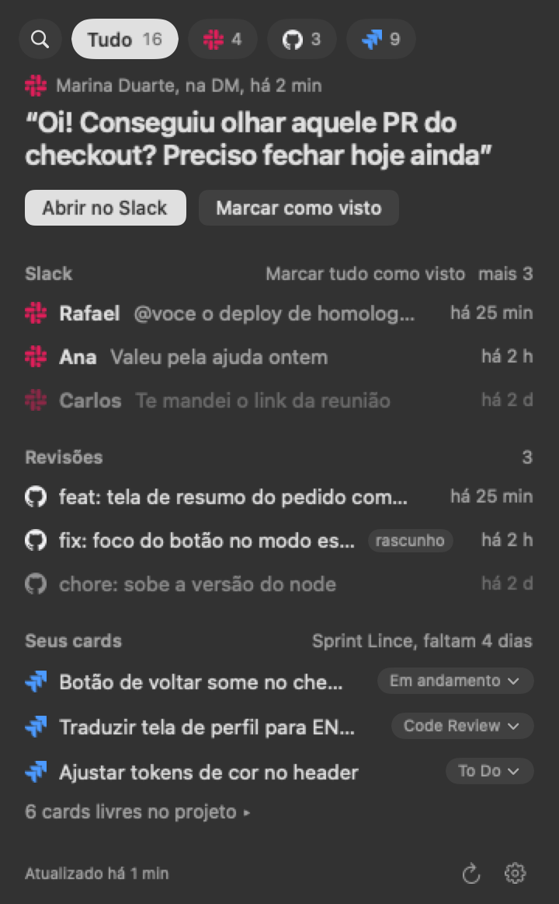

# Pauta

Jira, Slack e GitHub numa tela só, pela barra de menus do macOS: o que espera por você, com o mais recente em destaque.



O print usa dados de exemplo.

## Instalar

Hoje a instalação é por build local (veja **Build local**): rode `scripts/setup-signing.sh` uma vez e depois `scripts/build.sh --run`. Na primeira execução o Pauta entra nos itens de início do sistema.

Instalador `.dmg` e instalação pelo NeyHub chegam na próxima versão.

## Permissões

- **Notificações**: para avisar de mensagens novas do Slack quando o app do Slack está fechado (clicar abre a conversa). Dá pra desligar em Exibição.
- **Colar**: ao conectar Slack ou Jira, o macOS pode perguntar "Permitir colar?". Escolha **Permitir**, senão o Pauta não consegue ler o token copiado.
- O Pauta só lê o Slack (user token, sem bot) e só usa as APIs oficiais. O GitHub usa o `gh` que já está logado no terminal.

O app se chamava Radar: na primeira vez, a pasta do Radar é movida para a do Pauta, sem reconectar nada. O macOS pede de novo a permissão de notificações e a de colar; se sobrar "Radar" em Ajustes do Sistema → Geral → Itens de Início, remova.

**Privacidade**: os tokens só existem no arquivo local de credenciais (tabela abaixo), nunca no Keychain, nunca vão pra lugar nenhum além do Jira/Slack e nunca são escritos no log. A área de transferência só é vigiada enquanto um "Conectar" está aguardando (no máximo 10 min).

Tokens, estado e log ficam todos locais:

| O quê | Onde |
| --- | --- |
| Credenciais | `~/Library/Application Support/Pauta/credentials.json` (arquivo 0600, pasta 0700) |
| Estado do Slack (vistos, notificações já enviadas) | `~/Library/Application Support/Pauta/slack-state.json` |
| Log | `~/Library/Logs/Pauta/pauta.log` |

## Como usar

Jira, Slack e GitHub numa tela só, pela barra de menus do macOS. Um ícone (o `checklist`): um clique abre um popover que começa pelo **destaque**, a coisa mais recente que espera por você (uma mensagem do Slack ou um PR pedindo revisão), em letra grande e com as ações embaixo. Sem ninguém esperando, o destaque vira "Ninguém esperando você.". Embaixo ficam as seções, em linhas compactas com o logo de cada serviço, e um rodapé quieto com "Atualizado há X", ⟳ e ⚙︎. Seção sem nada para mostrar some.

- **Slack**: DMs e menções não lidas, sem a que está no destaque, com o texto já limpo (as 4 mais novas; "Ver mais N" mostra o resto). Marcar como visto tira o item da lista; "Marcar tudo como visto" marca só as mensagens que a tela mostra. Chegou algo novo e o Slack está fechado, vem uma notificação (clicar abre a conversa).
- **Revisões** (GitHub): os PRs abertos que esperam a **sua** revisão, sem o que está no destaque (título, há quanto tempo; rascunhos aparecem marcados). Clicar abre o PR. Sem notificação.
- **Seus cards** (Jira): os seus cards, com o nome da sprint e quantos dias faltam, e uma linha "N cards livres no projeto ▸" que abre os cards livres do projeto (agrupados). Dá pra mudar o status de um card e pegar um card livre sem abrir o navegador. Card do Jira nunca vira destaque.
- **O ícone da barra** é sempre o mesmo símbolo (`checklist`) com o total (Slack + Jira + GitHub) ao lado quando passa de 0, em que o Jira conta seus cards mais os livres, como a pílula Jira; um triângulo no lugar do símbolo avisa quando algum serviço falhou. O detalhe por serviço ("Pauta: Slack 3, Jira 2, GitHub 5") fica no tooltip. O ícone do app é gerado por `scripts/make-icon.swift`.
- **Atualiza sozinho**: a cada 2 minutos (ajustável em Exibição), ao abrir o popover (o que tiver mais de 15 s) e ao acordar o Mac. Na primeira execução o Pauta entra nos itens de início do sistema.
- Só lê o Slack (user token, sem bot) e só usa as APIs oficiais.

### Pílulas e busca

No topo do popover fica uma linha com a lupa e as pílulas **Tudo N**, **[Slack] N**, **[GitHub] N** e **[Jira] N** (só as dos serviços conectados). Cada uma mostra só a sua seção: Slack e GitHub com o destaque do próprio serviço ("Nada no Slack." / "Nenhum PR esperando você." quando vazio), Jira sem destaque e com os cards livres já abertos. As contagens: mensagens visíveis do Slack, PRs, seus cards mais os livres; Tudo é a soma.

A **busca** abre na lupa ou com **⌘F**: o campo "Filtrar por pessoa, canal, card" ocupa a linha de cima e as pílulas descem. Ela procura no nome da pessoa, no canal e no texto do Slack; no título, no repositório e no autor do PR; na chave e no título dos cards (seus e livres, sub-tarefas incluídas). Ignora maiúsculas e acentos; várias palavras exigem todas. Com texto digitado o destaque some, cada seção mostra só o que bate (seção vazia some, o Slack mostra tudo sem "ver mais"), os livres que batem aparecem numa seção "Livres" com o "Pegar", o trecho achado ganha um fundo cinza, as pílulas contam só os resultados e o rodapé diz "N resultados". Sem nada: "Nada com “termo”.". **Esc** (ou o ⊗) limpa o texto; com ele vazio, fecha a busca. Ao reabrir o popover, volta para Tudo com a busca fechada.

### Conectar (só clicar)

Abra o Pauta e clique no ícone: Slack e Jira sem conexão mostram um botão **Conectar Slack** / **Conectar Jira** (também nos ajustes ⚙︎, onde vira **Desconectar** depois de conectado). O Pauta abre a página certa no navegador e fica **"Aguardando você copiar o token…"** (até 10 min, dá pra cancelar). Quando você clica em **Copiar** na página, ele pega o token sozinho da área de transferência, valida na API, salva, limpa a área de transferência (se ela ainda tem o token) e mostra "Conectado como X". Se a validação falhar, mostra o erro e continua esperando. Só texto no formato do token do serviço é considerado (o site do Jira precisa ser https); qualquer outra coisa copiada é ignorada. Na primeira vez o macOS pode perguntar "Permitir colar?": escolha **Permitir**, senão o Pauta não consegue ler o token copiado. O fluxo continua mesmo com o popover fechado (ao ir ao navegador ele fecha sozinho).

#### Slack

1. **Conectar Slack** abre o "criar app a partir de manifesto" do Slack já preenchido (só escopos de leitura, user token).
2. Escolha o workspace da empresa e clique em **Criar**; depois **Install to Workspace** e **Permitir**.
3. Em **User OAuth Token**, clique em **Copy**. Se aparecer **"Request to Install"**, a empresa precisa aprovar: o Pauta fica esperando.

> Se o Slack ignorar o manifesto na URL, crie manualmente: <https://api.slack.com/apps> → **Create New App → From a manifest** e cole o conteúdo de `slack-manifest.yml`.

#### Jira

1. Digite o e-mail e o site do Jira (o endereço que aparece no navegador, com `https://`) e clique em **Conectar Jira**.
2. Na página de tokens, clique em **Criar token de API** (o sem escopos), dê qualquer nome e clique em **Criar**.
3. Clique em **Copiar**. O Pauta valida com `GET /rest/api/3/myself`: e-mail ou token errados aparecem como "e-mail ou token não bateram".

Sem projeto nos ajustes, o Pauta mostra os cards das sprints abertas de todos os projetos. Para um só, preencha a chave do projeto em **Ajustes → Avançado**; se ele tiver mais de um board, escolha o board ali também.

#### GitHub

Sem login nem token para copiar: o Pauta usa o `gh` que já está logado no terminal (`gh auth token`, procurado em `~/.local/bin`, `/opt/homebrew/bin` e `/usr/local/bin`; o token fica só em memória e é relido se a API devolver 401). Sem `gh` ou sem login, a seção mostra: `gh auth login`.

#### Avançado (colar token manualmente)

Em **Ajustes → Avançado (colar token manualmente)** ficam os campos de antes: site, e-mail e API token do Jira, projeto, board e user token do Slack.

## Atalhos

| Atalho | O que faz |
| --- | --- |
| `⌘F` | Abre a busca (ou clique na lupa) |
| `Esc` | Limpa o texto da busca; com ele vazio, fecha a busca |

## Modos de exibição

| Ajuste | Padrão | Efeito |
| --- | --- | --- |
| Menções em canais | ligado | Desligado, o Slack mostra só DMs: no destaque, na lista, na pílula, no número da barra e nas notificações. |
| Cards livres | ligado | Desligado, somem a linha "N cards livres" e os livres da pílula Jira, da busca e do número da barra. |
| Densidade | Confortável | Compacta: linhas mais baixas, destaque menor e menos espaço entre as seções. |
| Atualizar a cada | 2 min | 1, 2 ou 5 min; vale na hora, sem reiniciar. |
| Notificações do Slack | ligado | Desligado, o Pauta não posta notificação nenhuma (o registro de "já notificado" continua andando). |

Os ajustes valem na hora (tela e ícone da barra) e ficam em `UserDefaults` (domínio `local.pauta`), separados das credenciais.

## Atualizações

O Pauta confere o Slack, o Jira e o GitHub sozinho: a cada 2 minutos (ajustável em Exibição), ao abrir o popover (o que tiver mais de 15 s) e ao acordar o Mac. O app em si ainda não se atualiza sozinho: para atualizar, baixe o código novo e rode o build de novo (veja **Build local**).

## Build local

Precisa só das Command Line Tools (sem Xcode).

```sh
scripts/setup-signing.sh   # uma vez: certificado local de assinatura
scripts/build.sh --run     # compila, assina e abre build/Pauta.app
```

> O SDK atual transformou `@State` num macro cujo plugin só vem com o Xcode; as telas usam `@ViewState` (em `Views/ViewState.swift`), que faz a mesma coisa.

### Opções de linha de comando

Rodam sem abrir janela. Binário: `build/Pauta.app/Contents/MacOS/Pauta`.

| Flag | O que faz |
| --- | --- |
| `--check` | Confere as credenciais salvas nas APIs reais (sem credenciais, diz o que falta e sai com 1) |
| `--dump jira` | Imprime boards, sprint ativa, seus cards e os livres |
| `--dump slack` | Imprime DMs e menções não lidas |
| `--dump github` | Imprime quantos PRs esperam sua revisão e `repo#número título` de cada (usa o `gh`) |
| `--snapshots <pasta>` | Desenha cada tela (tudo, cada pílula, busca com e sem resultado, revisão, em dia, sem sprint, conectar, aguardando, erro, compacta, ajustes, ícone da barra) em PNG com dados de exemplo, sem tocar nas credenciais, na rede, na área de transferência nem no `gh` |
| `--selftest` | Roda as verificações internas e imprime `selftest ok` |

## Patch notes

Veja o [CHANGELOG](CHANGELOG.md).

## Licença

[MIT](LICENSE)
